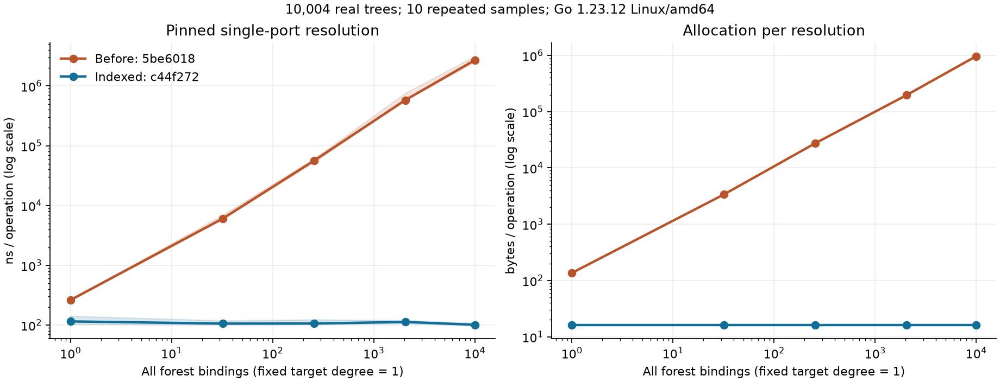

# Core routing performance results — 2026-10-28

Graph-owned routing removes per-call whole-forest binding sorting/scanning. The
measured benefit is specific to dependency resolution; whole-graph transaction
work and retained diagnostics remain. No public API or release tag changed.

## Sources and method

- Runtime baseline: `5be60184d928d9df23782d15630d6f855cfd0645`.
- Indexed Core: `c44f272dde42293da158174f5bc8e1e1b0c879cf`. Later changes are tests/tools/docs; all production Core bytes still match this measured candidate.
- Main harness: `a2c08ca`; Controller-large pairs: `59f178e`; separate RSS pairs: `3409c53`. Each pair uses the same frozen harness.
- Go 1.23.12 Linux/amd64, Intel i9-13900HX, Docker 8-CPU quota/8 GiB; PGO off. Single-CPU benchmark cases; parallel cases explicitly use CPU=1/2/4/8 with 1P/4P workers.
- 74 paired benchmark names, ten samples per side: 1,480 raw observations. Reported values are medians; min/max and every observation are retained. No significance test or production SLO is inferred.
- Main runs are sequential, not simultaneously load-tested. Short interleaved key-case repetitions are recorded separately in [repeat-data](repeat-data/comparison.json). These are a shared development machine, not isolated laboratory CPU measurements.

[Raw samples](data/samples.csv) · [summary/min/max](data/summary.json) · [pair comparisons](data/comparison.json) · [source identities](data/sources.json) · [validated methods](data/methods.json) · [file hashes](data/sha256.json)

Each run contains commands, dimensions, source-file hashes, actual module selection,
Go/binary build information, profile data and unedited successful benchmark output.
Binary VCS fields describe the outer checkout; the archived Core/harness SHAs,
source hashes and module replacement are the authoritative measured identities.

## Fixed target, unrelated bindings grow

10,004 actual trees, one unchanged target port/provider, target degree one.
The E=10,001 row comes from the large layered case.

| Total bindings | Before ns/op | Indexed ns/op | Before B/op | Indexed B/op |
| ---: | ---: | ---: | ---: | ---: |
| 1 | 262.05 | 114.95 | 136 | 16 |
| 32 | 6,026.50 | 105.70 | 3,384 | 16 |
| 256 | 56,000.00 | 105.85 | 27,448 | 16 |
| 2,048 | 578,731.00 | 112.65 | 196,792 | 16 |
| 10,001 | 2,698,596.00 | 100.75 | 966,840 | 16 |

The indexed cases allocate one 16-byte callback slice per successful single-value
resolution. Provider count, interface work, port descriptor lookup and scope
synchronization still cost time. This synthetic no-I/O result is not an application
speedup multiplier. Unchanged direct/nested paths also show timing variation, so
their differences are not attributed to this index.

## Counterbalanced check

After the primary experiment and native service checks, the key cases were rerun
in A → B → B → A order (A=baseline, B=indexed), three 300 ms samples per case in
each run. The paired harness/environment checks pass. Six samples per side give
E=1 medians 268.65 → 104.65 ns/op and E=2,048 medians 598,390 → 103.15 ns/op;
allocation remains 136 → 16 and 196,792 → 16 B/op respectively. This independent
24-observation repeat supports the routing slope result without treating it as
proof of CPU-isolated timings or a confidence interval. It is separate from the
1,480-observation primary study.

## Layering and Many

| Case | Before ns/op | Indexed ns/op | Before B/op | Indexed B/op |
| --- | ---: | ---: | ---: | ---: |
| 32 trees / 16 bindings / pinned | 2,942.50 | 97.36 | 1,976 | 16 |
| Direct Go interface, large fixture | 3.35 | 2.49 | 0 | 0 |
| Fresh Forest scope, empty callback | 441.90 | 377.45 | 320 | 320 |
| Nested Invoke in existing scope | 28.39 | 26.49 | 0 | 0 |
| Fresh scope + consumer entry + Ref | 2,543,125.50 | 670.05 | 967,160 | 336 |
| Controller admission only, 10,000 trees / 256 bindings | 396.20 | 375.70 | 320 | 320 |
| Controller + consumer + Ref, same fixture | 58,605.50 | 650.15 | 27,800 | 368 |
| Many degree 256, 1,024 trees / 512 bindings | 148,145.00 | 9,190.50 | 58,648 | 9,328 |

`RefPinned` excludes scope creation; `RefEnter` includes it. `RefParallel` is
wall-time throughput across independent pinned workers, not a latency percentile.
Many still scales with its own degree. Optional-unbound, declared ports=16/256,
nodes=256/2,048/20,004, degree=1/4/16/64/256 and parallel cases are in raw data.

## Index storage and management cost

The isolated builder benchmark uses descriptors from a real validated forest with
three port groups. It excludes graph cloning and validation. At 10,001 bindings,
the ten-sample median is **4.73 ms, 5,235,032 B/op, 28 allocs/op**. Live route slice
backing capacity is **1,048,800 bytes** per such graph, excluding map overhead and
the existing binding table. Transient construction allocation is larger than
retained storage. See [builder output](data/index-build.txt) and [source/command](data/index-build-metadata.json).

The heap profile attributes about 1.16 MiB of sampled in-use storage to indexRoutes.
Whole-profile totals are sampled estimates with substantial small-object variance;
they are not exact before/after memory differences. Candidate CPU read profiles
contain no per-read sortedBindings path; the baseline attributed 85.2% cumulative
CPU samples there. Heap/alloc/block/mutex and CPU runs are all separate.

At 10,000 trees / 256 bindings, medians (each real management sample is one
iteration, ten fresh/equivalent starting samples):

| Operation | Before ms | Indexed ms | Before MiB/op | Indexed MiB/op |
| --- | ---: | ---: | ---: | ---: |
| Preview | 152.041 | 148.617 | 139.290 | 139.260 |
| ApplyRebind | 87.309 | 71.605 | 10.134 | 10.221 |
| ApplyReplaceFresh | 81.350 | 72.049 | 10.134 | 10.224 |
| CommitFresh | 645.792 | 620.170 | 406.285 | 406.312 |
| Snapshot | 14.980 | 9.500 | 7.131 | 7.134 |
| Wait | 1.257 | 1.331 | 0.000 | 0.000 |

Rebind allocation rises by about 90 KiB here; at 32 trees it rises from 45,136
to 50,408 bytes. The index adds sorting/grouping and storage on every nonempty
candidate. Timing improvements in untouched Preview/Snapshot are not an index
optimization claim. Whole-graph copies, validation, journal cloning/fsync and
diagnostic scans remain substantial. CommitFresh excludes an external Preview,
but includes the Controller internal durable commit pipeline. No-op and real
history-prefix sizes 16/128 are reported separately.

## Synthetic offered load

Four workers, two reads per scope, two-second arrival plan, queue capacity 1,024,
one held old scope released mid-run. End-to-end includes planned-arrival delay;
execution-only excludes it. “20ms” requests alternating Replace/Rebind at that
period, but the serialized writer does not guarantee that many commits: the
large graph completed only 1–2 updates in the measured window.

| E / arrivals per second / update period | Completed / dropped before → after | E2E P95 ms before → after | E2E P99 ms before → after | Execution P95 ms before → after |
| --- | --- | ---: | ---: | ---: |
| 256 / 5,000 / 20ms | 10,000 / 0 → 10,000 / 0 | 1.831 → 1.103 | 3.588 → 1.501 | 0.446 → 0.006 |
| 10,001 / 1,000 / 0s | 2,000 / 0 → 2,000 / 0 | 1460.606 → 1.063 | 1511.425 → 1.151 | 12.771 → 0.011 |
| 10,001 / 5,000 / 0s | 2,192 / 7,808 → 10,000 / 0 | 1750.655 → 1.087 | 1767.815 → 1.182 | 12.340 → 0.009 |
| 10,001 / 5,000 / 20ms | 2,168 / 7,832 → 10,000 / 0 | 1874.552 → 1.090 | 1883.498 → 1.194 | 25.740 → 0.006 |

Every load run reports zero failed, invalid or unfinished calls; drops are counted,
not omitted. At E=10,001/5,000 arrivals per second the baseline only completed
2,192 of 10,000 arrivals without updates; 7,808 were dropped. Success percentiles
alone cannot describe that overload. These are single bounded workload samples,
not repeated statistical estimates or network/HTTP/database latency claims.

## Long-running resources, diagnostics, heap and RSS

Separate matching RSS harness, 10,000 replacements with eight real held calls;
three-tree physical-file fixture. Each created object owns a touched 128 KiB
payload; Stop closes and verifies the actual file handle.

| Stage | Diagnostics | Open files | Held versions | Heap MiB before → after | RSS MiB before → after |
| --- | ---: | ---: | ---: | ---: | ---: |
| initial | 3 | 2 | 0 | 0.339 → 0.334 | 2.750 → 2.750 |
| held | 10,003 | 10 | 8 | 4.849 → 4.840 | 13.004 → 14.531 |
| released | 10,003 | 2 | 0 | 3.825 → 3.811 | 12.746 → 14.516 |
| closed | 10,003 | 0 | 0 | 3.582 → 3.568 | 10.977 → 14.695 |

Both versions retain diagnostics and release actual resources: 10 open files while
eight generations are held, two current files after join/drain, zero after Close.
The closed Forest is still held for that diagnostic sample; it is discarded after
sampling. Successful stopped records are separately tested to clear implementation,
capability and dependency references. RSS can remain high or increase after GC:
it includes allocator/OS residency and is not live Go heap or a resource leak test.

Ten thousand Rebinds create no new instance diagnostics (three throughout) and
also finish with zero open files. The 1,000-round replace/rebind/mixed H=0/1/8
matrix and cumulative TotalAlloc, Snapshot/Wait time, states and goroutine counts
are retained. The index does not prune diagnostics or optimize their O(I) scans.

## Collection corrections and limits

1. Initial archive extraction failed because the Go 1.23 image Python predates the filter keyword; validated extraction was corrected in a new run. No Core samples from that setup were used.
2. The first large Controller case exceeded the existing 10,000-tree manifest cap. The native Core N=10,004/E=10,001 case stays intact; Controller uses N=10,000/E=256.
3. Successful small/large files from run `20261028-062801-baseline-complete` are retained even though a later case failed. Its failed case is excluded. A separate Controller attempt exceeded the default test timeout and is excluded entirely.
4. Controller fixtures were moved to parent-benchmark ownership to avoid rebuilding thousands of trees on every calibration. Both paired Controller-large runs use frozen harness `59f178e`; timed calls are unchanged.
5. Windows coarse clock resolution produced some zero-duration smoke observations; Windows checks establish behavior, not nanosecond performance conclusions. Primary metrics are Linux.
6. A Windows real-service attempt failed downloading the official Temporal CLI before tests started. A later complete run passed; checksum-verified release archives can be reused by the host runner. Failed evidence is retained locally.

No Core transaction/lifecycle architecture, Adapter production code, TestKit API,
Agent Runtime or Focus product behavior was changed. The full candidate and
published-version evidence is summarized in [acceptance](validation.md).
